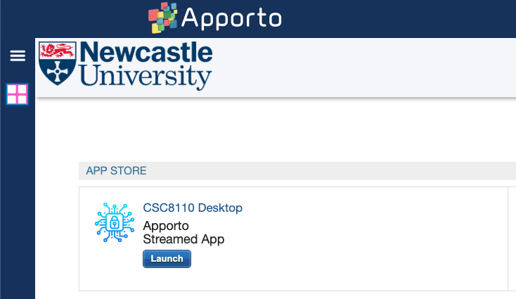
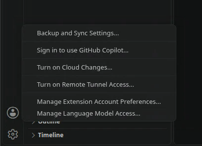

# Apporto platform

## Getting started

1. Login to Canvas with your school account and pick your module.
2. Click this "Apporto Virtual Desktops"
3. Click Launch to connect




## Troubleshooting

### 1. `Insufficient permissions to access MicroK8s`

If running `microk8s kubectl get pods -A` returns a permission error, add your user (`aws.admin`) to the `microk8s` group and reload the session.

1. **Add the user to the `microk8s` group and update `.kube` ownership**

   ```bash
   sudo usermod -a -G microk8s aws.admin
   sudo chown -R aws.admin ~/.kube
   newgrp microk8s
   ```

   > **Note:** `newgrp` only applies the new group to the current shell. Log out and back in (or reconnect over SSH) to apply it to all sessions.

   **Verification:** Run `microk8s kubectl get pods -A` without `sudo` and confirm it outputs the pod table cleanly.

### 2. Container Registry Pod Stuck in `Pending` / Older Pods Stuck in `Terminating`

After a VM clone or a hostname/IP change, `microk8s kubectl get pods -A` may show older pods stuck in `Terminating` and the new `container-registry` pod stuck in `Pending`. This is caused by a stale, unreachable node (`node.kubernetes.io/unreachable` taint).

1. **Remove the stale `NotReady` node**

   Identify the old `NotReady` node name, then force-remove it from Kubernetes and `dqlite`:

   ```bash
   microk8s kubectl get nodes
   sudo microk8s remove-node <old-node-name> --force
   ```

   **Verification:** Run `microk8s kubectl get nodes` and confirm only the active node appears, with status `Ready`.

2. **Force-delete stuck `Terminating` pods**

   Clear any lingering pods from the old node that remain in `Terminating` status:

   ```bash
   microk8s kubectl delete pod -n container-registry registry-9865b655c-7ns2j --grace-period=0 --force
   microk8s kubectl delete pod -n kube-system calico-kube-controllers-6c99c8747f-j6n6f coredns-7745f9f87f-lt88d hostpath-provisioner-58694c9f4b-2pckr --grace-period=0 --force
   ```

   > **Note:** Pod names are specific to your cluster. Run `microk8s kubectl get pods -A | grep Terminating` to get the names of the pods that are stuck in your case.

   **Verification:** Run `microk8s kubectl get pods -A` and confirm no pods remain in `Terminating` status.

3. **Reset the container registry storage onto the active node**

   Disable and re-enable the registry addon so its `PersistentVolumeClaim` (`registry-claim`) binds to a fresh `hostpath` volume on the active node:

   ```bash
   sudo microk8s disable registry
   sudo microk8s enable registry
   ```

   > **Warning:** Disabling the registry deletes its PVC, so any images previously pushed to `localhost:32000` are lost. Re-push them after the registry is back up.

   **Verification:** Run `microk8s kubectl get pods -n container-registry` and confirm the new `registry` pod reaches `1/1 Running`.
   
## Launching applications

You can launch the following GUI applicaitons from the VM:

* VSCode
  * Type `code` in the terminal to launch VSCode
* Firefox
  * Type `firefox` in the terminal to launch Firefox

## File transfer from your computer

This uses VS Code's Remote Tunnels feature to connect VS Code on your own computer to the Apporto VM, so you can transfer files between them.

> [!IMPORTANT]
> You will need VS Code installed on your OWN computer for this to work.

1. **In the Apporto VM**, launch VS Code and install the **Remote Tunnels** extension from the Extensions Marketplace.
2. **In the Apporto VM**, click the account icon in the bottom-left corner of VS Code and select **Turn on Remote Tunnel Access...**

    

3. Select **Install as a service**. Choose "use weak encryption" if prompted.
 > [!NOTE]
 > You can use your personal account for this step.
4. Choose either **Sign in with GitHub** or **Sign in with Microsoft**
5. Wait until VS Code reports that the tunnel is active (you'll see a notification, and the account icon will show a green tunnel indicator)
6. **On your own computer**, Open the Command Palette (`Ctrl+Shift+P` / `Cmd+Shift+P`) and run **Remote Tunnels: Connect to Tunnel...**
    * Sign in with the same account you used in the Apporto VM
    * Select the VM's tunnel from the list (it will be named after the VM's hostname)
7. Once connected, open the folder you want to work with on the VM (e.g. **File > Open Folder...**)
8. You can now drag and drop files between your computer and the VM directly in the VS Code Explorer, or use the integrated terminal to copy files across
